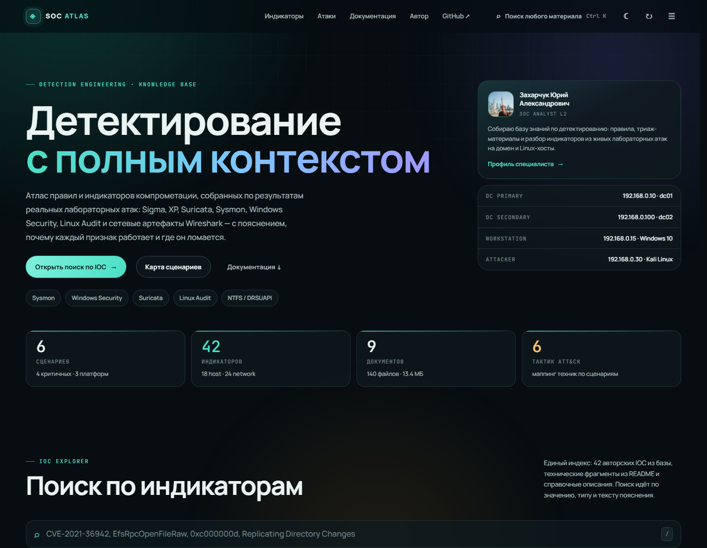
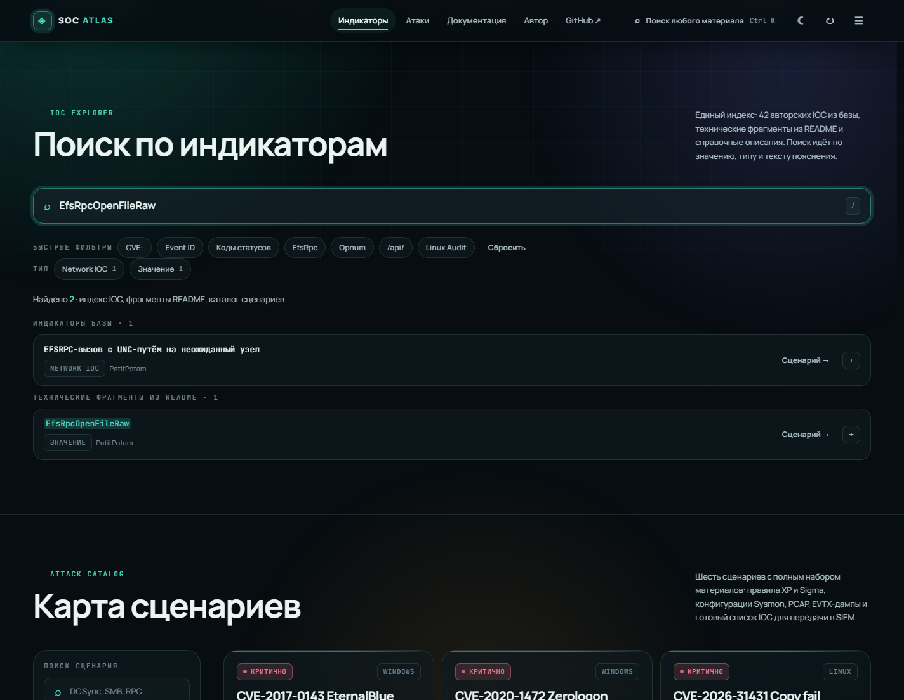
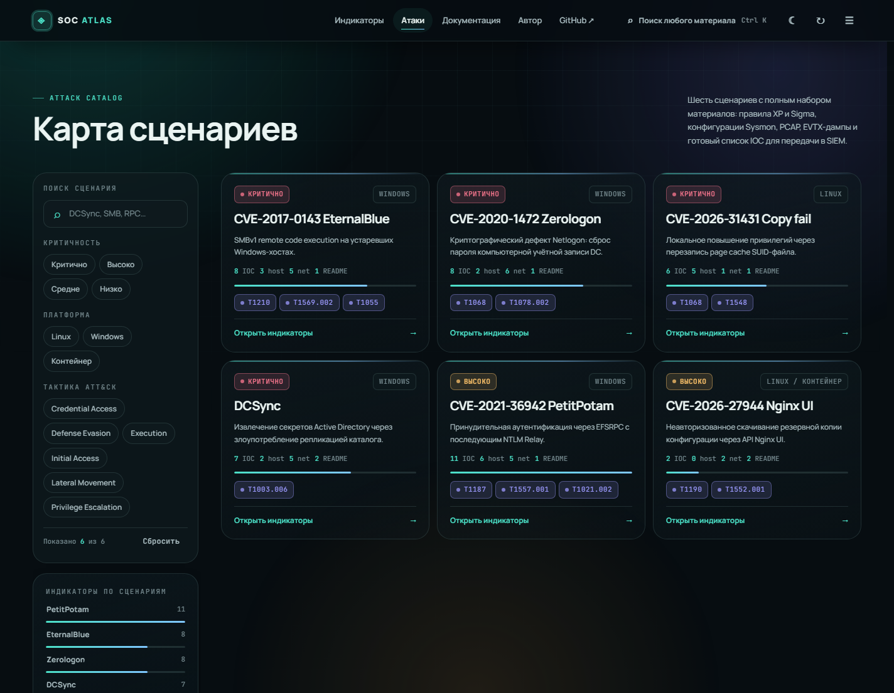
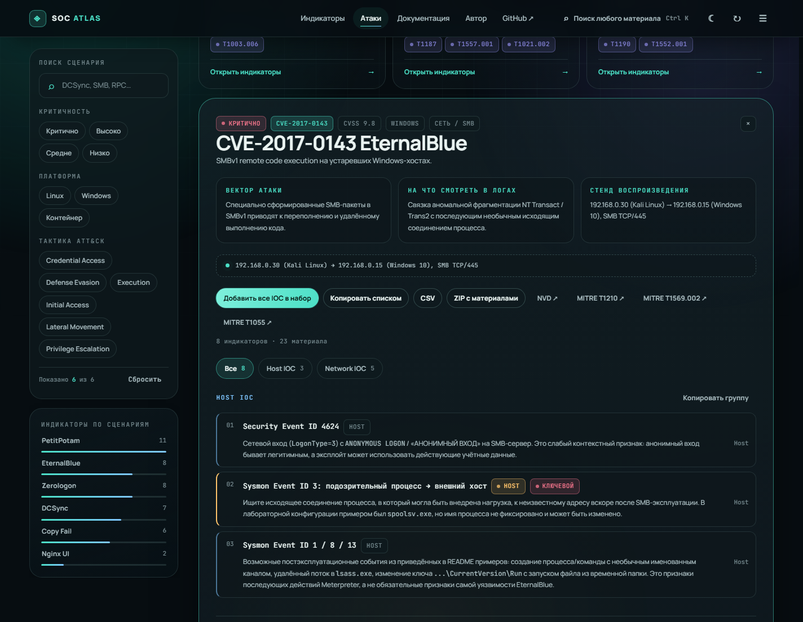
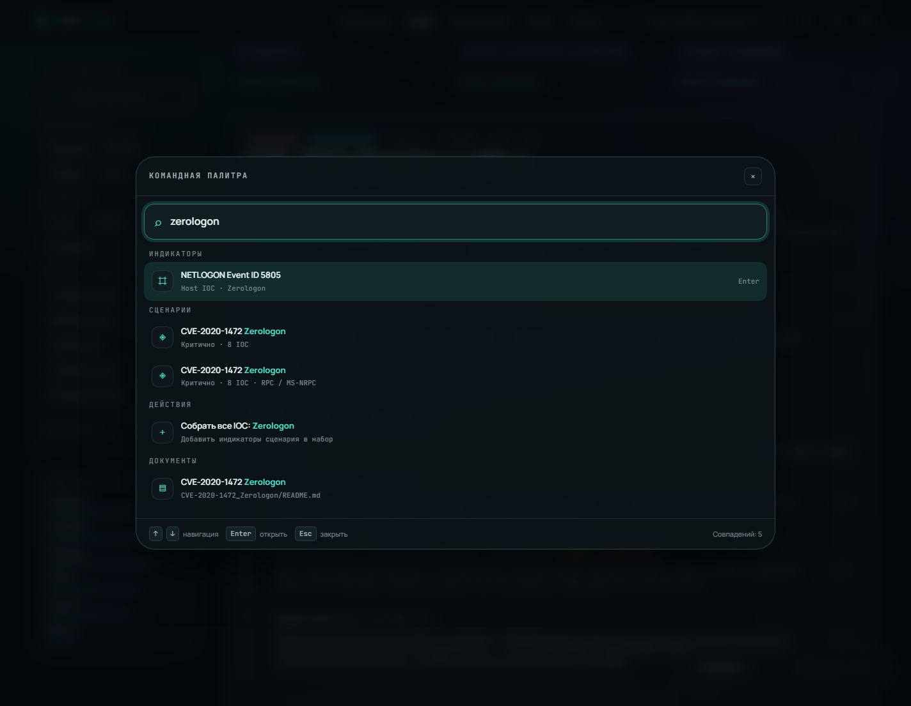
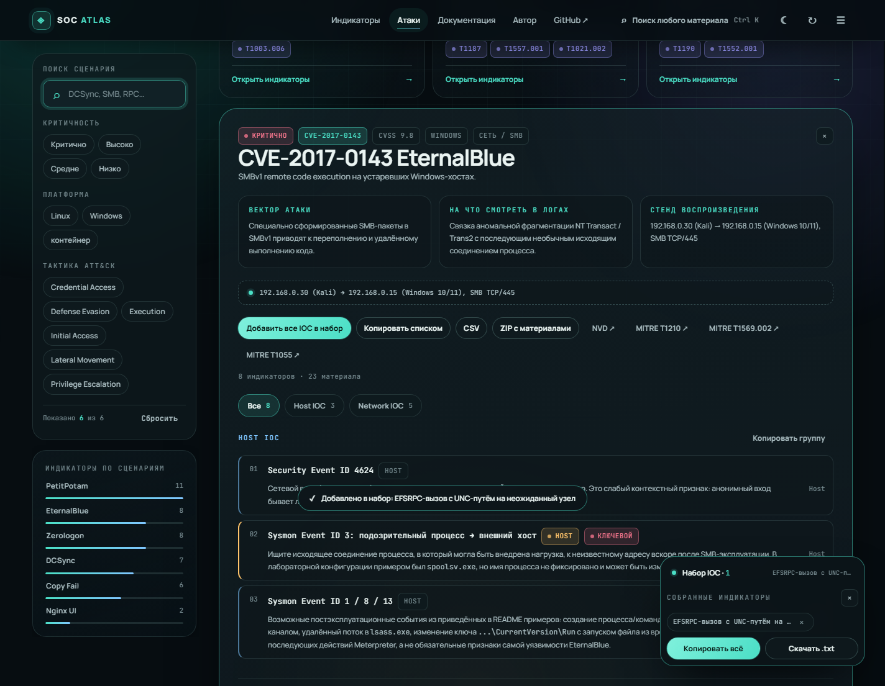
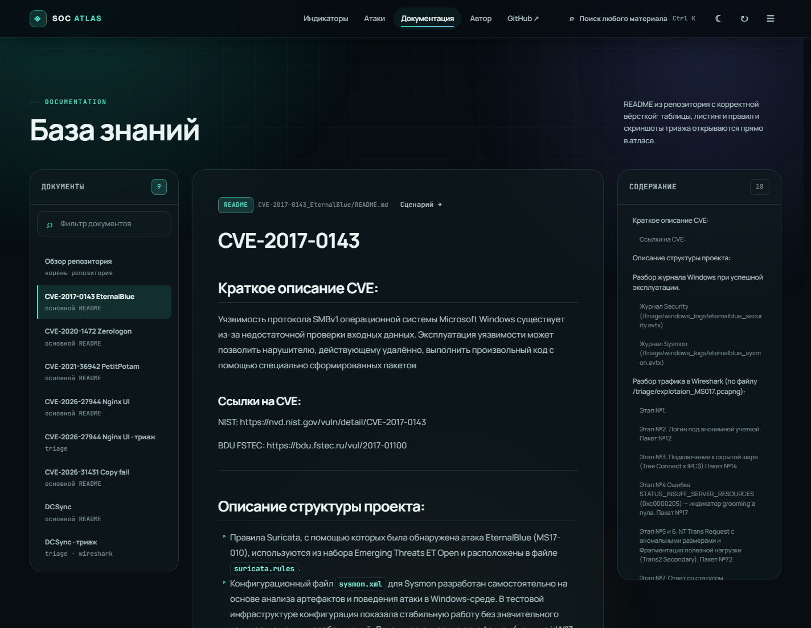
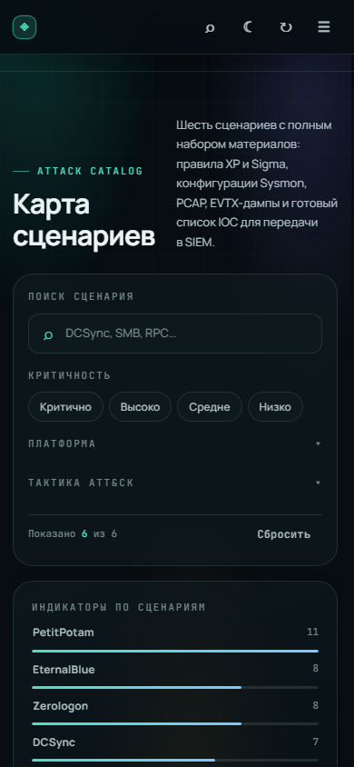

# 🛡️ SOC Detection Rules

**Автор:** Захарчук Юрий Александрович  
**Роль:** Аналитик SOC 

Репозиторий содержит базу знаний и правила детектирования для аналитиков SOC. Здесь собраны Sigma/XP/Suricata, Sysmon/Auditd-правила, PoC-скрипты и материалы для триажа инцидентов.

## 🖥️ Веб-атлас (SOC Atlas)

Поверх репозитория работает FastAPI-приложение `app/` — интерактивный атлас правил и индикаторов.

```bash
pip install -r requirements.txt
uvicorn app.main:app --reload --port 8000     # http://127.0.0.1:8000
```

### Всё об атаках — в одном файле [`IOC`](./IOC)

`IOC` — единственный источник сведений об атаках: название, CVE, критичность, CVSS,
платформа, техники ATT&CK, стенд, индикаторы и ссылки. В коде (`app/main.py`, разметка,
скрипты интерфейса) этих данных нет: приложение только читает файл и отдаёт его в API,
а раздел `## LAB` заполняет карточку стенда на главной странице.

Файл рассчитан на ручное ведение:

```markdown
# ── АТАКА ──
ATTACK
name: EternalBlue
folder: CVE-2017-0143_EternalBlue     # папка с материалами (README, PCAP, EVTX, правила)
cve: CVE-2017-0143
severity: Критично                    # Критично | Высоко | Средне | Низко
cvss: 9.8
platform: Windows
surface: Сеть / SMB
category: Удалённое выполнение кода
tagline: Короткое описание для карточки.
vector: Как именно эксплуатируется уязвимость.
focus: На что смотреть в логах.
techniques: T1210 = Lateral Movement  # продолжения — строками с отступом
  T1569.002 = Execution

LAB
attacker :: 192.168.0.30 · Kali Linux :: запуск PoC :: TCP/445

HOST IOC
- Security Event ID 4624 :: Сетевой вход с ANONYMOUS LOGON на SMB-сервер.
- ❗ Sysmon Event ID 3 :: Ищите исходящее соединение процесса во внешний хост.
  Пояснение можно продолжить строкой с отступом.

NETWORK IOC
- SMB STATUS_INVALID_PARAMETER (0xC000000D) :: Признак обработки эксплойта.

REFERENCES
NVD :: https://nvd.nist.gov/vuln/detail/CVE-2017-0143 :: карточка уязвимости

SKIP RULES
normalization
correlation
```

Как добавить атаку: скопировать блок, заполнить поля, сохранить файл и нажать ↻ в шапке
атласа. Папка с материалами находится по `folder`, иначе по `cve`, иначе по имени сценария.
Если у сценария нет сетевых индикаторов — раздел `NETWORK IOC` просто остаётся пустым.

Служебные разделы файла: `## LAB` — общий стенд (узлы и роли), `## THREAT INTELLIGENCE` —
площадки с отчётами, `## SKIP` — папки, которые не показывать в атласе (`AD_CS_ESC`).

Возможности интерфейса:

| Раздел | Что делает |
| :--- | :--- |
| **Поиск по индикаторам** | Единый индекс: авторские IOC, технические фрагменты из README, названия сценариев и пояснения. Быстрые фильтры и фасеты по типу. |
| **Карта сценариев** | Сценарии с критичностью, платформой, тактиками ATT&CK, числом индикаторов и правил. Фильтры по критичности, платформе и тактике. |
| **Консоль сценария** | Вектор атаки, на что смотреть в логах, таблица стенда, группы Host / Network IOC с пояснениями, ссылки, экспорт в CSV, ZIP с материалами и открытие README. |
| **Правила сценария** | Все правила из папки атаки: Sigma, Suricata, Sysmon, auditd и XP (нормализация / корреляция). Вкладки по типам, просмотр кода, копирование одного правила или всего набора, скачивание файла. |
| **База знаний** | README репозитория: список документов слева, текст по центру, содержание документа — в правой колонке с подсветкой текущего раздела. Листинги копируются, скриншоты открываются в лайтбоксе. |
| **Командная палитра** | `Ctrl + K` — поиск по сценариям, индикаторам, фрагментам и документам, плюс быстрые действия. |
| **Набор IOC** | Сбор индикаторов из поиска и сценариев в один список с копированием и выгрузкой в `.txt`. |

### Правила детектирования в атласе

Панель «Правила детектирования» в консоли сценария собирает правила прямо из папки атаки,
поэтому отдельный реестр вести не нужно: достаточно положить файл в привычное место.

| Тип | Что распознаётся |
| :--- | :--- |
| **Sigma** | папка `Sigma_rules/`, файл `sigma.yml`, любой YAML с `title:` / `logsource:` / `detection:` |
| **Suricata** | файлы `*.rules`, папка `suricata_rules/` |
| **Sysmon** | `sysmon.xml`, папка `sysmon/` |
| **auditd** | `audit.rules`, папка `auditd/` |
| **XP · нормализация** | папка `normalization_rule/`, `normalization_event.txt` |
| **XP · корреляция** | папка `correlation_rule/`, файлы `rule.co`, `formula.xp` |
| **KUMA / MaxPatrol / Wazuh / ELK / Splunk** | файлы и папки с соответствующими именами; список типов расширяется в `RULE_KINDS` внутри `app/main.py` |

Служебные файлы (`metainfo.yaml`, переводы `i18n`, каталоги `tests/`, материалы `triage/`)
в список не попадают. Содержимое правила загружается только при открытии — страница
не утяжеляется, даже если правил в сценарии десятки.

Экспорт CSV отдаётся с UTF-8 BOM и CRLF, поэтому Excel открывает кириллицу без «кракозябр».

Горячие клавиши: `Ctrl + K` — палитра, `/` — фокус в поиск, `1…3` — разделы, `T` — тема (тёмная/светлая), `Esc` — закрыть панель или палитру.

### Скриншоты

| | |
| :--- | :--- |
|  |  |
|  |  |
|  |  |
|  |  |

API: `/api/meta`, `/api/summary`, `/api/attacks`, `/api/attacks/{id}`, `/api/attacks/{id}/tray?format=json|text|csv`, `/api/attacks/{id}/bundle` (ZIP), `/api/search`, `/api/readme`, `/api/shortcuts`, `/api/reindex`.

Проверки перед коммитом:

```bash
python tools/smoke_api.py                       # контракт API
node tools/check-modules.mjs app/static         # модули и ссылки на ассеты
node tools/browser-check.mjs http://127.0.0.1:8000/ tools/ui-scenario.json
node tools/browser-check.mjs http://127.0.0.1:8000/ tools/ui-mobile.json
```

## 🕵️ Threat Intelligence Reports

Полезные площадки с аналитическими отчётами, исследованиями APT-группировок и Threat Intelligence-фидами от ведущих российских ИБ-вендоров:

- 🟢 **[Kaspersky Threat Intelligence](https://www.kaspersky.ru/enterprise-security/threat-intelligence)** — сервисы и отчёты Kaspersky по анализу угроз, APT-репорты, TI-фиды
- 🔴 **[PT ESC Threat Intelligence](https://ptsecurity.com/research/pt-esc-threat-intelligence/)** — исследования Positive Technologies Expert Security Center
- 🟣 **[F6 Research Hub](https://www.f6.ru/resources/research-hub/)** — база исследований и отчётов F6 (ex. F.A.C.C.T. / Group-IB)
- 🔵 **[BI.ZONE Research](https://bi.zone/expertise/research/)** — аналитические материалы и отчёты BI.ZONE

---


## 🖥️ Hosts (Lab Environment)

| IP               | Hostname | Role / OS                  | Notes                                      |
| :--------------- | :------- | :-------------------------- | :------------------------------------------ |
| **192.168.0.10**  | `dc01`   | Windows Server — Domain Controller (primary) | Основной DC, источник событий 4624/4662, DRSUAPI |
| **192.168.0.100** | `dc02`   | Windows Server — Domain Controller (secondary) | Вторичный DC / реплика                      |
| **192.168.0.15**  | —        | Windows 10/11 Desktop       | Рабочая станция, точка входа для клиентских атак (PetitPotam, EternalBlue) |
| **192.168.0.30**  | —        | Kali Linux                  | Атакующая машина / хост для PoC и инструментов (Impacket, Responder и т.д.) |

---

## 📋 Information about CVE

| CVE / Technique    | Title                                                           | Description                                                                                                                                                                                                          | Link                                                                                              |
| :----------------- | :-------------------------------------------------------------- | :------------------------------------------------------------------------------------------------------------------------------------------------------------------------------------------------------------------- | :------------------------------------------------------------------------------------------------ |
| **CVE-2017-0143**  | Windows SMB Remote Code Execution Vulnerability *(EternalBlue)* | Уязвимость SMBv1 в Windows, позволяющая удалённому атакующему выполнить произвольный код с помощью специально сформированных SMB-пакетов.                                                                            | [NVD](https://nvd.nist.gov/vuln/detail/CVE-2017-0143) · [Detection](./CVE-2017-0143_EternalBlue)  |
| **CVE-2021-36942** | Windows EFS RPC Service Vulnerability *(PetitPotam)*            | Уязвимость EFS RPC позволяет инициировать принудительную аутентификацию Windows-системы. В сочетании с NTLM Relay может использоваться для дальнейшей атаки на инфраструктуру Active Directory.                      | [NVD](https://nvd.nist.gov/vuln/detail/CVE-2021-36942) · [Detection](./CVE-2021-36942_PetitPotam) |
| **CVE-2026-27944** | Nginx UI Vulnerability                                          | Уязвимость Nginx UI, для которой характерным сетевым индикатором в данном наборе правил является обращение к API endpoint `/api/backup`.                                                                             | [NVD](https://nvd.nist.gov/vuln/detail/CVE-2026-27944) · [Detection](./CVE-2026-27944_Nginx%20UI) |
| **DCSync**         | DCSync / NTDS.dit Dump                                          | Техника получения учетных данных Active Directory посредством злоупотребления механизмом репликации каталога. Для обнаружения используются сетевые признаки DRSUAPI/DRSGetNCChanges и событие Windows Security 4662. | [MITRE T1003.006](https://attack.mitre.org/techniques/T1003/006/) · [Detection](./DCSync)         |

---

## 🔎 Detection

| Attack                          | Detection                                                                                                                                                                                                                                                                                                                                                                                                                                                                                                                                                                                                                                                                                              |
| :------------------------------ | :----------------------------------------------------------------------------------------------------------------------------------------------------------------------------------------------------------------------------------------------------------------------------------------------------------------------------------------------------------------------------------------------------------------------------------------------------------------------------------------------------------------------------------------------------------------------------------------------------------------------------------------------------------------------------------------------------- |
| **EternalBlue (CVE-2017-0143)** | **Sysmon Event ID: 3**<br>  └─ Network connection<br><br>**Security Event ID: 4624**<br>  └─ An account was successfully logged on<br><br>**Network IOC**<br>  └─ `Trans2 Response: STATUS_INVALID_PARAMETER (0xc000000d)`                                                                                                                                                                                                                                                                                                                                                                                                                                                                             |
| **PetitPotam (CVE-2021-36942)** | **Sysmon Event ID: 3**<br>  └─ `Initiated=false → DC:445`<br>  └─ `Initiated=true → Attacker:445`<br><br>**Sysmon Event ID: 18**<br>  └─ `PipeConnected`<br><br>**SMBClient Event ID: 30805**<br>  └─ `0xC00000C3`<br><br>**SMBClient Event ID: 30816**<br>  └─ `0xC00000CC`<br><br>**SMBClient Event ID: 31012**<br>  └─ `GUID {4141...}`<br><br>**SMBClient Event ID: 31013**<br>  └─ `0xC000A000`<br><br>**SMBServer Event ID: 551**<br>  └─ `0xc000006d`<br><br>**Security Event ID: 4624**<br>  └─ `LogonType=3, NULL SID`<br><br>**Network IOC**<br>  └─ `EfsRpcOpenFileRaw`<br>  └─ `WERR_BAD_NETPATH`<br>  └─ `NTLM Negotiate / Challenge / Authenticate`<br>  └─ `SMB TCP/445 (DC as client)` |
| **Nginx UI (CVE-2026-27944)**   | **HTTP Request**<br>  └─ `GET /api/backup`                                                                                                                                                                                                                                                                                                                                                                                                                                                                                                                                                                                                                                                             |
| **DCSync (T1003.006)**          | **Security Event ID: 4624**<br>  └─ `Logon Type: 3`<br><br>**Security Event ID: 4662**<br>  └─ `ObjectServer: DS`<br>  └─ `AccessMask: 0x100`<br>  └─ `Properties: 1131f6aa-9c07-11d1-f79f-00c04fc2dcd2`<br>    └─ `Replicating Directory Changes All`<br><br>**DRSUAPI**<br>  └─ UUID: `e3514235-4b06-11d1-ab04-00c04fc2dcd2`<br>  └─ `DRSGetNCChanges (Opnum: 3)`                                                                                                                                                                                                                                                                                                                                    |

---

## 🌐 Network Detection

| Attack                          | Network IOC                                                                                                                                                                                                                                                                    |
| :------------------------------ | :----------------------------------------------------------------------------------------------------------------------------------------------------------------------------------------------------------------------------------------------------------------------------- |
| **EternalBlue (CVE-2017-0143)** | **SMB Trans2 Response**<br>  └─ `NT Status: STATUS_INVALID_PARAMETER (0xc000000d)`                                                                                                                                                                                             |
| **PetitPotam (CVE-2021-36942)** | **EFS RPC**<br>  └─ `EfsRpcOpenFileRaw`<br>  └─ `WERR_BAD_NETPATH`<br><br>**NTLM**<br>  └─ `Negotiate / Challenge / Authenticate`<br><br>**SMB**<br>  └─ `TCP/445 (DC as client)`<br>  └─ `SMB2 Negotiate (Dialect 0x0202)`                                                    |
| **DCSync (T1003.006)**          | **RPC Endpoint Mapper**<br>  └─ `TCP/135`<br><br>**DRSUAPI**<br>  └─ UUID: `e3514235-4b06-11d1-ab04-00c04fc2dcd2`<br>  └─ `DRSGetNCChanges (Opnum: 3)`<br><br>**RPC**<br>  └─ Dynamic RPC port<br>  └─ `Auth Level: Packet Privacy`<br>  └─ Large fragmented DCE/RPC responses |
| **Nginx UI (CVE-2026-27944)**   | **HTTP Request**<br>  └─ `GET /api/backup`                                                                                                                                                                                                                                     |

---

## 💻 Host Detection

| Attack                          | Windows / Linux IOC                                                                                                                                                                                                                                                                                                                                                                                                                                                                                                             |
| :------------------------------ | :----------------------------------------------------------------------------------------------------------------------------------------------------------------------------------------------------------------------------------------------------------------------------------------------------------------------------------------------------------------------------------------------------------------------------------------------------------------------------------------------------------------------------- |
| **EternalBlue (CVE-2017-0143)** | **Sysmon Event ID: 3**<br>  └─ Network connection<br><br>**Security Event ID: 4624**<br>  └─ An account was successfully logged on                                                                                                                                                                                                                                                                                                                                                                                              |
| **PetitPotam (CVE-2021-36942)** | **Sysmon Event ID: 3**<br>  └─ `Initiated=false → DC:445`<br>  └─ `Initiated=true → Attacker:445`<br><br>**Sysmon Event ID: 18**<br>  └─ `PipeConnected`<br><br>**SMBClient Event ID: 30805**<br>  └─ `0xC00000C3`<br><br>**SMBClient Event ID: 30816**<br>  └─ `0xC00000CC`<br><br>**SMBClient Event ID: 31012**<br>  └─ `GUID {4141...}`<br><br>**SMBClient Event ID: 31013**<br>  └─ `0xC000A000`<br><br>**SMBServer Event ID: 551**<br>  └─ `0xc000006d`<br><br>**Security Event ID: 4624**<br>  └─ `LogonType=3, NULL SID` |
| **Nginx UI (CVE-2026-27944)**   | **HTTP Request**<br>  └─ `GET /api/backup`                                                                                                                                                                                                                                                                                                                                                                                                                                                                                      |
| **DCSync (T1003.006)**          | **Security Event ID: 4624**<br>  └─ `Logon Type: 3`<br><br>**Security Event ID: 4662** — An operation was performed on an object<br>  └─ `ObjectServer: DS`<br>  └─ `AccessMask: 0x100`<br>  └─ `Properties: 1131f6aa-9c07-11d1-f79f-00c04fc2dcd2`<br>    └─ `Replicating Directory Changes All`                                                                                                                                                                                                                                |

---

## 📚 Attack Resources

| Attack                      | Resources                                                                                                                                               |
| :-------------------------- | :------------------------------------------------------------------------------------------------------------------------------------------------------ |
| **Zerologon**               | [Habr — Zerologon](https://habr.com/ru/companies/bizone/articles/526168/)<br>[Habr — Zerologon](https://habr.com/ru/companies/rvision/articles/743142/) |
| **PetitPotam / NTLM Relay** | [Habr — PetitPotam / NTLM Relay](https://habr.com/ru/companies/ussc/articles/688682/)<br>[Hackndo — NTLM Relay](https://en.hackndo.com/ntlm-relay/)     |
| **DCSync**                  | [Habr — DCSync](https://habr.com/ru/companies/rvision/articles/709866/)<br>[Habr — DCSync](https://habr.com/ru/companies/rvision/articles/709942/)      |
| **EternalBlue (MS17-010)**  | [Habr — EternalBlue / MS17-010](https://habr.com/ru/companies/k2tech/articles/892202/)                                                                  |

---

**© 2026 Захарчук Юрий Александрович** — Все права защищены.  
Данный материал подготовлен для внутреннего использования в SOC и образовательных целях.
